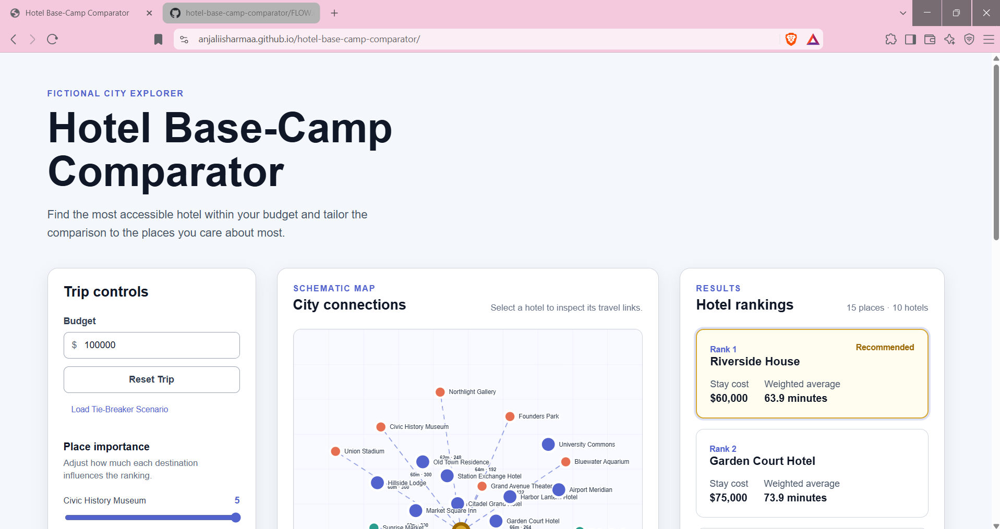
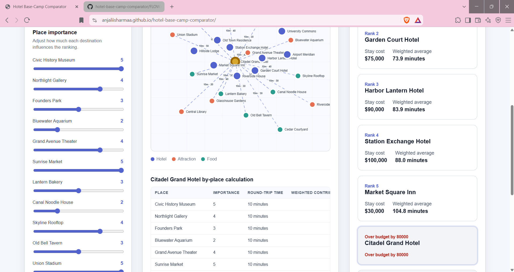
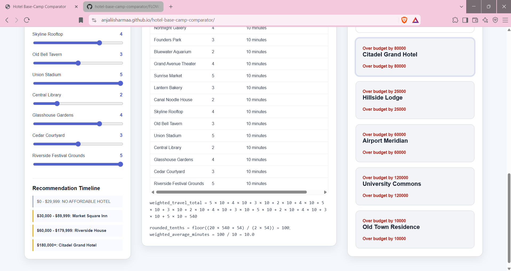
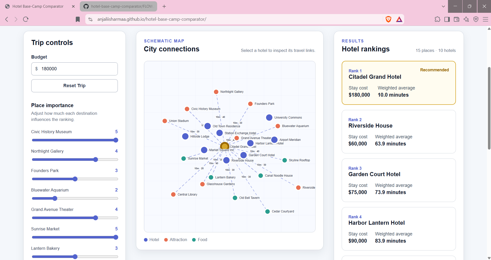
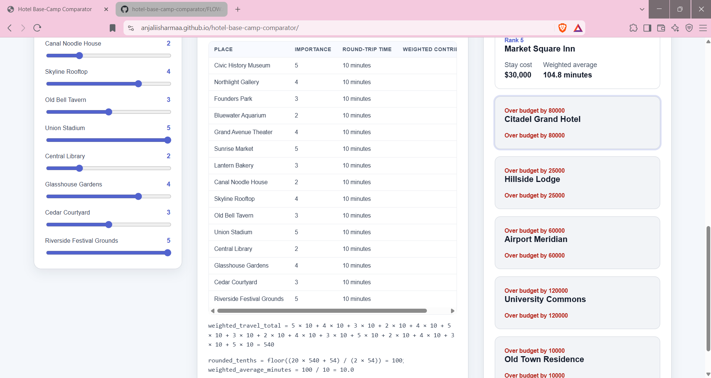
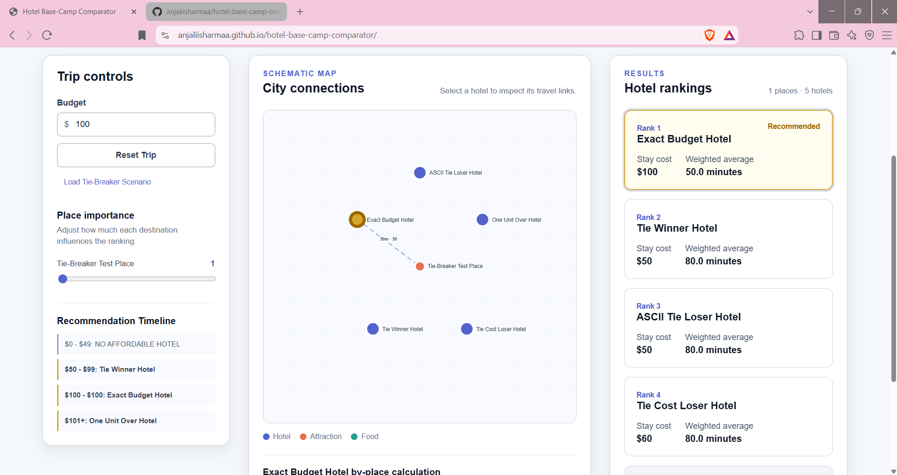

# Hotel Base-Camp Comparator

A local, dependency-free decision aid that balances lodging budget against weighted travel times to 15 specific city locations, built with strict mathematical predictability.

## Situation
Planning a city trip requires balancing a fixed lodging budget against the daily travel time to a rigid wishlist of attractions and food stops. Promotional hotel phrases don't help groups evaluate the real mathematical trade-offs between cost and accessibility.

## Task
Build a fully interactive, browser-based "Hotel Base-Camp Comparator" using vanilla web technologies (no external APIs). The system must deterministically calculate weighted travel averages, rank affordable hotels, gracefully handle edge cases (like identical ties and exact budget boundaries), and prove its math transparently.

## Action
I acted as the technical lead, strictly managing GitHub Copilot through a mandatory `FLOW.md` audit trail. The AI was required to document architectural logic *before* generating code, preventing hallucinated math and enforcing a strict **Unidirectional Data Flow**:

1. **Deterministic Data Generation:** Hardcoded 15 wishlist places (9 attractions, 6 food) and 10 hotels with a complete 10x15 travel-time matrix.
2. **Validation Gatekeeper:** Built `validateScenario()` to ensure the calculation engine never processes malformed data or invalid states.
3. **Pure Calculation Engine:** Implemented strict integer-only rounding formulas (`floor((20 * total + importance) / (2 * importance)) / 10`) to eliminate floating-point errors, and a chained `.sort()` algorithm for three-tier tie-breaking.
4. **Custom SVG Map & Two-Way Sync:** Built a dependency-free schematic map where `x` and `y` coordinates are used *only* for visual clustering, entirely decoupled from the travel-time math. Connected markers to dynamically generated calculation tables.
5. **Edge-Case Dependency Injection:** Added a hidden "Load Tie-Breaker Scenario" to swap the 10x15 dataset with a 5-hotel test array, mathematically proving budget equality and tie-breaker rules without cluttering the main UI.

## Result
A mathematically sound, interactive web app that instantly ranks hotels based on budget and user-weighted place importance. 

### Visual & Test Evidence
The application successfully demonstrates the required boundaries (e.g., dynamically changing the #1 recommendation when the budget crosses $180,000) and explicitly proves its calculations.

**Main Workspace & Schematic Map:**
*(The SVG map accurately clusters markers without relying on pixel distance for calculations)*

**Accessible Calculation Details:**
*(Two-way synchronization allows users to click a hotel and view the exact integer-rounding formula and weighted contribution breakdown)*

**Edge-Case & Tie-Breaker Proof:**
*(The dependency-injection scenario proves budget equality, over-budget exclusion by exactly 1 unit, stay-cost tie-breaking, and ASCII ID tie-breaking)*

### Live Demo
[Click to view](https://anjaliisharmaa.github.io/hotel-base-camp-comparator/)